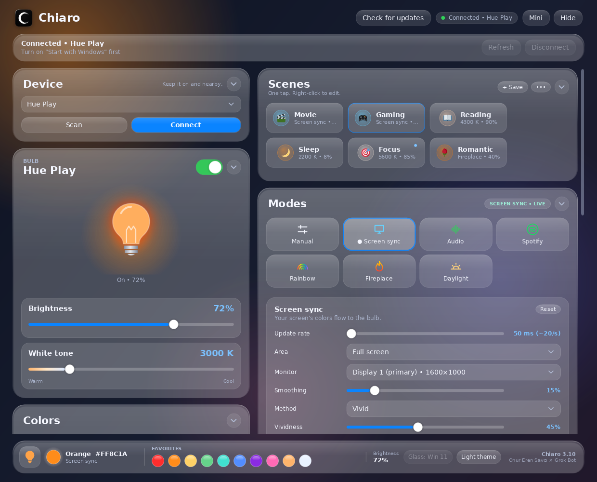
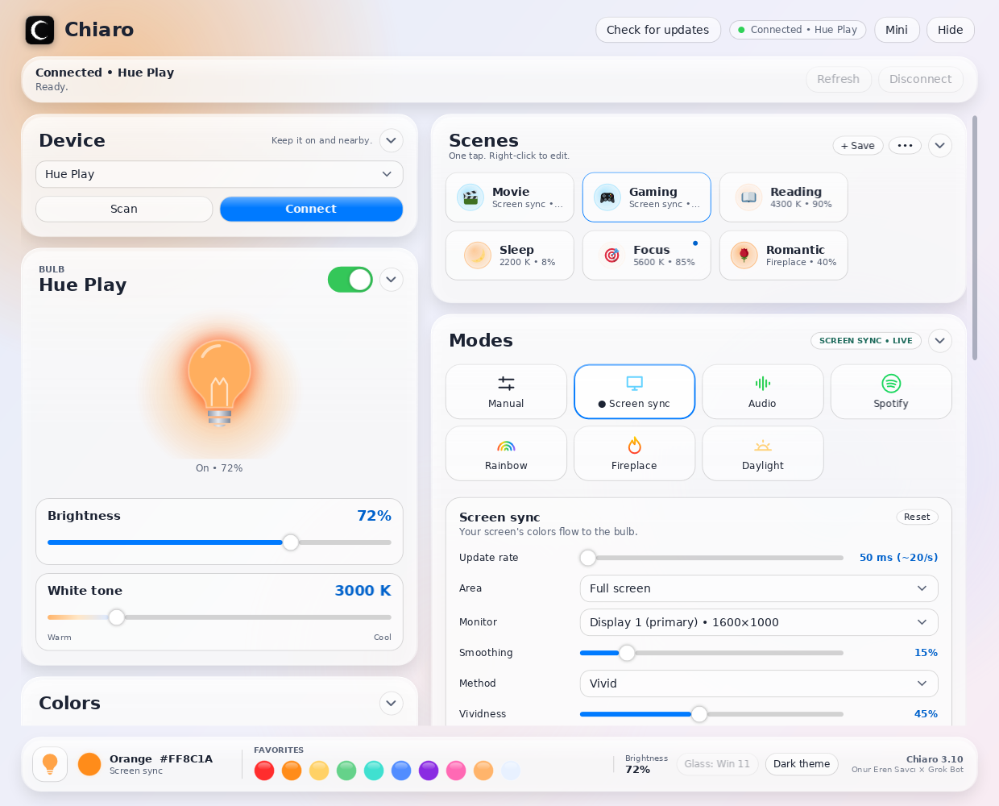
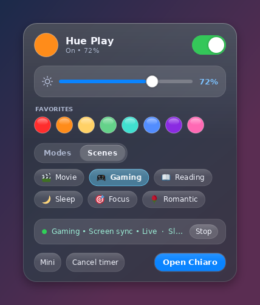
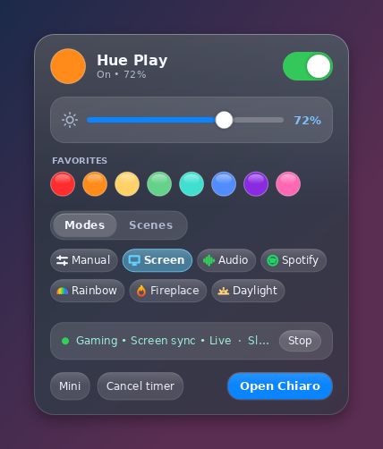
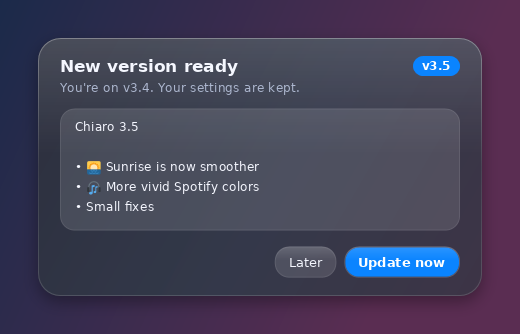
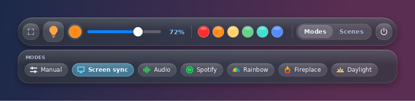
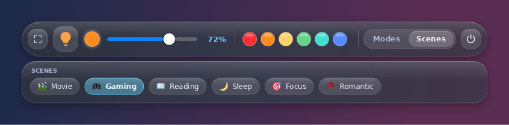
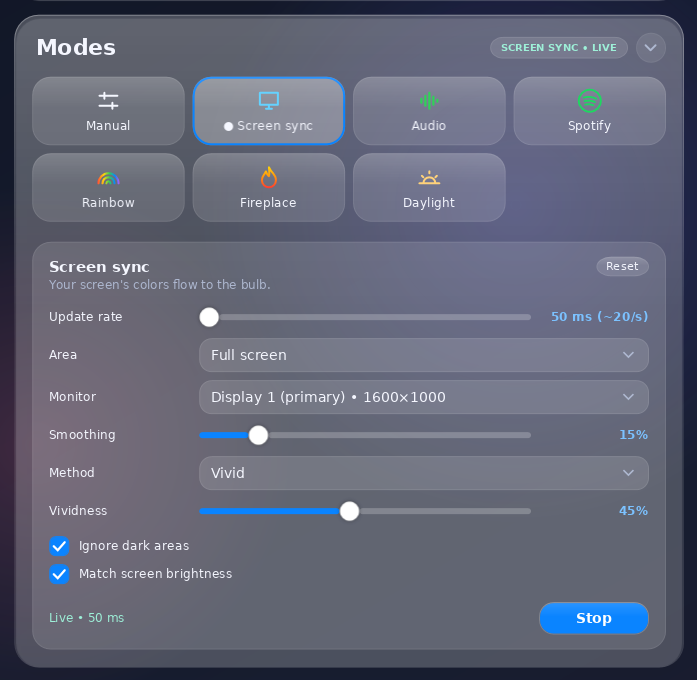
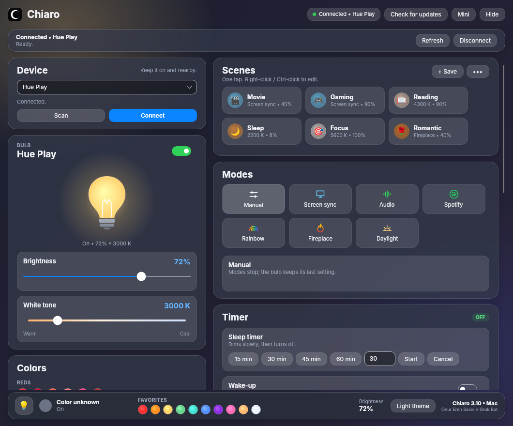

<p align="center">
  
</p>

<h1 align="center">Chiaro</h1>

<div align="center">

[🇹🇷 Türkçe](README.md) | **🇬🇧 English**

</div>

<p align="center"><b>A sleek Windows and macOS remote for your Philips Hue Bluetooth bulbs. No bridge, no cloud, just light.</b></p>

<p align="center"><i>An independent app for Philips Hue Bluetooth bulbs; not affiliated with Philips or Signify.</i></p>

<p align="center">
  <a href="https://github.com/onurerensavci/chiaro/releases/latest"></a>
  
  
  
  
</p>

Chiaro lets you control Philips Hue Bluetooth bulbs from Windows or a Mac **without a Hue Bridge**, straight over your computer's Bluetooth.
Set the color, brightness and white tone, and sync the light with your screen, your music or the time of day.

**Chiaro** is Italian for “light”, from *chiaroscuro*, the painters' play of light and shadow. A duel of light and shadow, like Light and L.

This is my first project of its kind; I built every step of it, from the idea to the design, together with **Grok Bot**.



## ✨ Features

- 🪟 **Liquid Glass interface**: frosted-glass cards, dark and light themes, smooth animations.
- 🎬 **Scenes**: Movie, Gaming, Reading, Sleep, Focus, Romantic… Each scene has its own emoji. Apply one with a single tap, overwrite it with the current light, rename it or change its emoji. Reset the built-in scenes to their defaults whenever you like.
- 🖥️ **Screen sync**: the color on your screen flows to the bulb in real time. Area, monitor, smoothing, method and vividness are all adjustable.
- 🎵 **Audio**: the light reacts to the rhythm and loudness of your music.
- 🎧 **Spotify / music**: brings the album-cover color of the current track to the bulb.
- 🌈 **Rainbow**: a color cycle with adjustable direction, palette and speed.
- 🔥 **Fireplace**: a warm, flickering fire effect with sparks.
- ☀️ **Daylight**: color temperature and brightness that follow natural daylight through the day.
- ⏱️ **Timers**: a sleep timer, a wake-up that slowly brightens like a sunrise, and weekly schedules.
- 🔔 **Notification light**: the bulb briefly flashes for Discord, WhatsApp, Teams and Outlook notifications, then returns to how it was.
- ⚡ **Quick panel**: left-click the tray icon next to the clock for power, brightness and favorites at your fingertips. Use the **Modes / Scenes** tabs to apply a scene or start a mode; the active one is highlighted and the last tab is remembered.
- 🖱️ **Scroll for brightness**: turn the mouse wheel over the tray icon.
- 📌 **Mini mode**: a slim always-on-top bar, with a compact panel that opens from its Modes and Scenes tabs.
- 🎨 **45 preset colors + a color wheel**, HEX input and favorite colors.
- 🔄 **In-app updates**: when a new version is out, an **Update** button appears in the header and a small notice shows in the quick panel. Read the release notes and download with one click; the file is verified, the app updates itself and restarts. You can also check manually with **Check for updates**.
- 🌍 **English and Turkish**: the interface opens in English or Turkish depending on your system language; change it in **Settings → Dil / Language** and it applies instantly, without a restart.
- 🚀 **Start with Windows**: starts quietly in the tray at sign-in. On a Mac, **Open at login** starts it in the menu bar only. Turn on **Settings → Turn on light at startup** and it also connects to your last bulb and switches the light on. **Restore last mode** restarts the mode that was running when you shut down (e.g. Screen sync), even if you changed the light from another app in the meantime (both only act when Chiaro starts with your computer, so Start with Windows / Open at login must be on). **Turn off light when computer shuts down** sends a turn-off command to the bulb when your computer shuts down or restarts; quitting the app normally or updating it leaves the light alone (this one works whether or not Start with Windows is on).
- 🍎 **macOS (Apple Silicon)**: the same interface on the Mac: scenes, Screen sync, Audio (system audio or microphone), Spotify / Music, Rainbow, Fireplace, Daylight, timers, a menu bar icon, mini mode and in-app updates.

## 📸 Screenshots

| Light theme | Quick panel |
| --- | --- |
|  |  |

| Quick panel: Modes | Update |
| --- | --- |
|  |  |

**Mini mode: Modes and Scenes**




**Mode settings**



**macOS**



## ⬇️ Download

Get the latest version from the **[Releases page](https://github.com/onurerensavci/chiaro/releases/latest)**:

- **Windows:** `Chiaro_v3.10.exe`. No installation needed; it's a single file with .NET included.
- **macOS:** `Chiaro_v3.10_mac.zip`. Open the zip and move **Chiaro.app** to your **Applications** folder.

Later versions can be updated from inside the app. Each file's SHA-256 is in the release notes and in the `.sha256` file next to it.

## 🧰 Requirements

- **Windows:** Windows 10 (2004 / 19041 or later) or Windows 11, 64-bit, with a Bluetooth adapter that supports Bluetooth LE
- **macOS:** a Mac with Apple Silicon (M1 or later, arm64) running macOS 13 Ventura or later. Intel Macs aren't supported.
- A Bluetooth-capable Philips Hue bulb (the ones with the Bluetooth symbol on the box)

## 🚦 First run

### Windows

1. Run `Chiaro_v3.10.exe`. Because the app isn't signed, Windows SmartScreen may show a warning:
   **More info → Run anyway**.
2. Turn the bulb on and bring it close to the computer. The bulb needs to be discoverable over Bluetooth. If needed, make it visible in the Hue app on your phone under
   *Settings → Voice assistants → Make visible*, and turn off the phone's Hue Bluetooth connection.
3. Press **Scan**, pick your bulb and press **Connect**. From then on it connects automatically.

### macOS

1. Open `Chiaro_v3.10_mac.zip` and move **Chiaro.app** to the **Applications** folder (open at login and in-app updates work best from there).
2. Because the app isn't signed and notarized by Apple, macOS shows a *"Chiaro" cannot be verified* warning the first time:
   - **macOS 15 Sequoia and later:** press **Done**, then go to **System Settings → Privacy & Security**, scroll down and press **Open Anyway** next to "Chiaro was blocked", then confirm.
   - **macOS 14 Sonoma and earlier:** **right-click (Control-click) Chiaro → Open**, then **Open** again.
3. **Scan** → pick your bulb → **Connect**. macOS asks for Bluetooth permission on the first scan.

#### macOS permissions

- **Bluetooth:** to find and control the bulb (asked on the first scan).
- **Screen & System Audio Recording:** for Screen sync and the *System audio* source of the Audio mode. Turn on Chiaro under **System Settings → Privacy & Security → Screen & System Audio Recording** (*Screen Recording* on macOS 14 and earlier), then restart Chiaro. Nothing is recorded; only the average color and the sound level are read.
- **Microphone:** when the Audio mode's source is *Microphone*.
- **Automation:** for the Spotify mode, to read the current track and cover from Spotify (or Music).

If you denied a permission by mistake, Chiaro shows a notice in that mode with a button that opens the right settings page.

## ⚠️ Known limitations

- Works over Bluetooth only; there is no control through a Hue Bridge / Zigbee.
- One bulb is controlled at a time. Bluetooth range is a few meters.
- The computer may not be able to connect while the Hue app on your phone is connected to the bulb.
- Screen and audio sync speed is limited by Bluetooth (about 20 updates per second).
- Spotify / music mode works with players that provide a Windows media session.
- The notification light polls the Windows notification database read-only; it reads only the app name, never the content.
- The app isn't code-signed (hence the SmartScreen warning on Windows and the Gatekeeper warning on a Mac).
- Settings are stored in `%LOCALAPPDATA%\HueBluetooth` on Windows and `~/Library/Application Support/HueBluetooth` on a Mac.
- On a Mac there's no notification light or scroll-wheel brightness yet. The Spotify mode on a Mac reads the Spotify desktop app (and optionally Apple Music). DRM-protected videos may show as black in screen capture.
- The update check asks GitHub only for the latest release, at most once a day at startup; no other data is sent. The folder containing the exe must be writable (e.g. Documents or Desktop).

## 🛠️ Building from source

Requires the [.NET 10 SDK](https://dotnet.microsoft.com/download).

```bash
git clone https://github.com/onurerensavci/chiaro.git
cd chiaro/src/Chiaro
dotnet publish -c Release -r win-x64 --self-contained true -p:PublishSingleFile=true
```

Output: `bin/Release/net10.0-windows10.0.19041.0/win-x64/publish/Chiaro.exe`

macOS package (on Linux or a Mac; ad-hoc signing needs [rcodesign](https://github.com/indygreg/apple-platform-rs)):

```bash
cd chiaro/src/ChiaroMac
Packaging/build-mac.sh artifacts artifacts/Chiaro_mac.zip
```

## 💬 Feedback

I'll keep finding what's missing and updating it as I use it; please post suggestions and bugs in [Issues](https://github.com/onurerensavci/chiaro/issues).

## 🙌 Credits

Idea and design: **Onur Eren Savcı** • Development: **Grok Bot**

## ⚖️ License and disclaimer

Distributed under the [MIT](LICENSE) license.

Chiaro is an independent app for Philips Hue Bluetooth bulbs; not affiliated with Philips or Signify. Philips Hue is a registered trademark of Signify.
