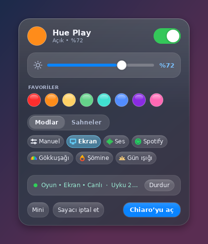
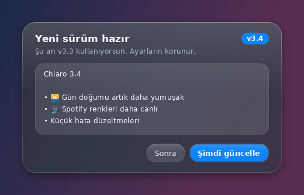
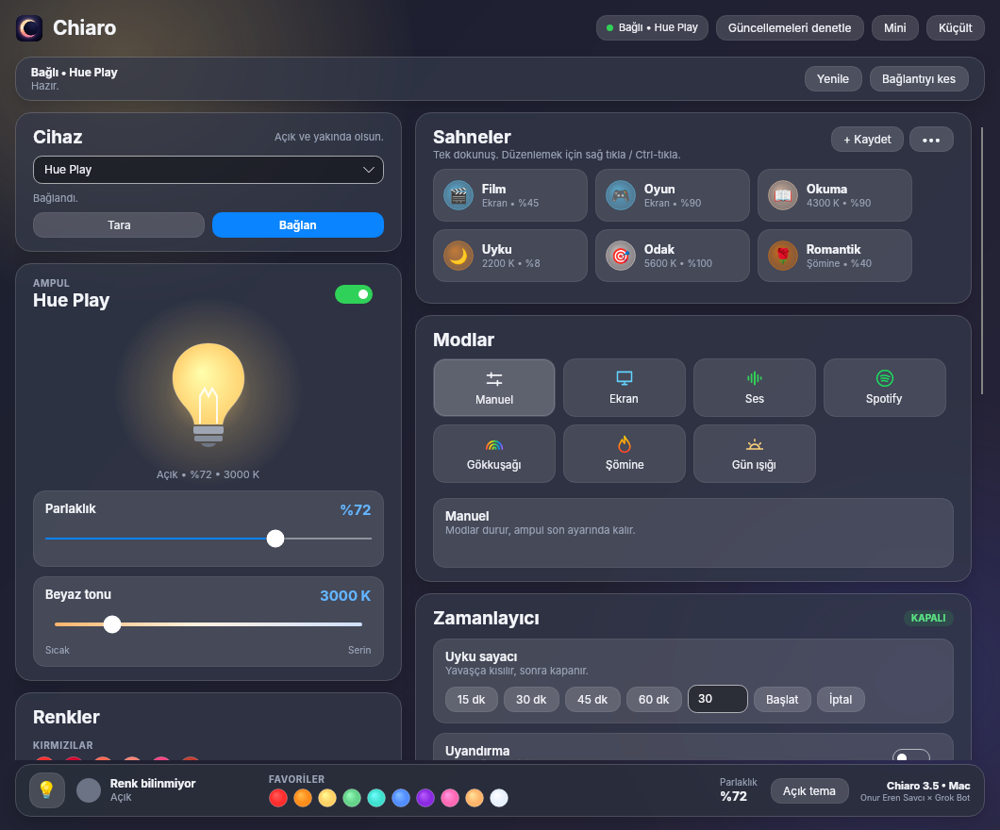

<p align="center">
  
</p>

<h1 align="center">Chiaro</h1>

<div align="center">

**🇹🇷 Türkçe** | [🇬🇧 English](README.en.md)

</div>

<p align="center"><b>Philips Hue Bluetooth ampullerin için şık bir Windows ve macOS kumandası. Köprü yok, bulut yok, sadece ışık.</b></p>

<p align="center"><i>Philips Hue Bluetooth ampuller için bağımsız bir uygulamadır; Philips/Signify ile bağlantısı yoktur.</i></p>

<p align="center">
  <a href="https://github.com/onurerensavci/chiaro/releases/latest"></a>
  
  
  
  
</p>

Chiaro, Philips Hue Bluetooth ampullerini **Hue Bridge olmadan**, doğrudan bilgisayarının Bluetooth'u ile Windows'tan ya da Mac'ten kontrol etmeni sağlar.
Rengi, parlaklığı ve beyaz tonunu ayarla; ekranınla, müziğinle ya da günün saatiyle senkron çalıştır.

**Chiaro**, İtalyanca “ışık” demek; ressamların ışık ile gölge oyunu *chiaroscuro*'dan gelir. Işık ile gölgenin düellosu, tıpkı Light ile L gibi.

Bu, benim bu türdeki ilk projem; fikirden tasarıma her adımını **Grok Bot** ile birlikte geliştirdim.


## ✨ Özellikler

- 🪟 **Liquid Glass arayüz**: cam efektli kartlar, koyu ve açık tema, akıcı animasyonlar.
- 🎬 **Sahneler**: Film, Oyun, Okuma, Uyku, Odak, Romantik… Her sahnenin kendi emojisi var. Tek dokunuşla uygula, şu anki ışıkla üzerine yaz, yeniden adlandır, emojisini değiştir. Hazır sahneleri istediğin zaman varsayılana sıfırla.
- 🖥️ **Ekran senkronu**: ekrandaki renk anlık olarak ampule yansır. Alan, monitör, yumuşatma, yöntem ve canlılık ayarlanabilir.
- 🎵 **Ses**: ışık müziğin ritmine ve şiddetine göre tepki verir.
- 🎧 **Spotify / müzik**: çalan şarkının albüm kapağının rengini ampule taşır.
- 🌈 **Gökkuşağı**: yönü, paleti ve hızı ayarlanabilen renk döngüsü.
- 🔥 **Şömine**: kıvılcımlı, titreşen sıcak ateş efekti.
- ☀️ **Gün ışığı**: gün boyu doğal ışığı izleyen sıcaklık ve parlaklık.
- ⏱️ **Zamanlayıcı**: uyku sayacı, gün doğumu gibi yavaşça aydınlanan uyandırma ve haftalık programlar.
- 🔔 **Bildirim ışığı**: Discord, WhatsApp, Teams, Outlook bildirimlerinde ışık kısa süre yanıp söner, sonra önceki haline döner.
- ⚡ **Hızlı panel**: saat yanındaki simgeye sol tıkla; aç/kapa, parlaklık ve favoriler elinin altında. **Modlar / Sahneler** sekmeleriyle sahneyi uygula ya da modu başlat; etkin olan vurgulanır, son sekme hatırlanır.
- 🖱️ **Simgede tekerlekle parlaklık**: tepsi simgesinin üzerinde fare tekerleğini çevir.
- 📌 **Mini mod**: her zaman üstte duran ince çubuk. Modlar ve Sahneler sekmeleriyle açılır kompakt panel.
- 🎨 **45 hazır renk + renk çarkı**, HEX girişi ve favori renkler.
- 🔄 **Uygulama içi güncelleme**: yeni sürüm çıkınca başlıkta **Güncelle** düğmesi ve hızlı panelde küçük bir uyarı belirir. Sürüm notlarına bak, tek tıkla indir; dosya doğrulanır, uygulama kendini yeniler ve yeniden açılır. İstersen **Güncellemeleri denetle** ile elle de bakabilirsin.
- 🌍 **Türkçe ve İngilizce**: arayüz sistem diline göre Türkçe ya da İngilizce açılır; **Ayarlar → Dil / Language** ile değiştir, yeniden başlatmadan anında uygulanır.
- 🚀 **Windows ile başlat**: açılışta sessizce saat yanında başlar. Mac'te **Oturum açılışında başlat** ile yalnızca menü çubuğunda başlar. İstersen **Ayarlar → Bilgisayar açılınca ışığı aç** ile açılışta son ampule bağlanıp ışığı da açar; **Son modu geri aç** ile de bilgisayarı kapatırken açık olan modu (ör. Ekran) yeniden başlatır, ışığı başka bir uygulamadan değiştirmiş olsan bile (ikisi de yalnız bilgisayarla birlikte başlayınca çalışır; bunun için Windows ile başlat / Oturum açılışında başlat açık olmalı).
- 🍎 **macOS (Apple Silicon)**: aynı arayüz Mac'te de var: sahneler, Ekran, Ses (sistem sesi ya da mikrofon), Spotify / Müzik, Gökkuşağı, Şömine, Gün ışığı, zamanlayıcı, menü çubuğu simgesi, mini mod ve uygulama içi güncelleme.

## 📸 Ekran görüntüleri

| Açık tema | Hızlı panel |
| --- | --- |
|  |  |

| Hızlı panel: Modlar | Güncelleme |
| --- | --- |
|  |  |

**Mini mod: Modlar ve Sahneler**


**Mod ayarları**


**macOS**



## ⬇️ İndir

En son sürümü **[Releases sayfasından](https://github.com/onurerensavci/chiaro/releases/latest)** indir:

- **Windows:** `Chiaro_v3.8.exe`. Kurulum gerekmez; tek dosya, .NET dahil.
- **macOS:** `Chiaro_v3.8_mac.zip`. Zip'i aç, çıkan **Chiaro.app**'i **Uygulamalar** klasörüne taşı.

Sonraki sürümleri uygulamanın içinden güncelleyebilirsin. Her dosyanın SHA-256 değeri sürüm notlarında ve yanındaki `.sha256` dosyasında.

## 🧰 Gereksinimler

- **Windows:** Windows 10 (2004 / 19041 veya üstü) ya da Windows 11, 64 bit; Bluetooth LE destekli bir Bluetooth adaptörü
- **macOS:** Apple Silicon (M1 ve sonrası, arm64) bir Mac, macOS 13 Ventura veya üstü. Intel Mac'ler desteklenmez.
- Bluetooth özellikli bir Philips Hue ampul (kutusunda Bluetooth simgesi olanlar)

## 🚦 İlk çalıştırma

### Windows

1. `Chiaro_v3.8.exe` dosyasını çalıştır. Uygulama imzalı olmadığı için Windows SmartScreen uyarı verebilir:
   **Daha fazla bilgi → Yine de çalıştır**.
2. Ampulü aç ve bilgisayara yaklaştır. Ampulün Bluetooth ile keşfedilebilir olması gerekir. Gerekirse telefondaki Hue uygulamasında
   *Ayarlar → Sesli asistanlar → Görünür yap* ile ampulü görünür yap ve telefonun Hue Bluetooth bağlantısını kapat.
3. **Tara**'ya bas, ampulünü seç ve **Bağlan**. Sonraki açılışlarda otomatik bağlanır.

### macOS

1. `Chiaro_v3.8_mac.zip` dosyasını aç ve **Chiaro.app**'i **Uygulamalar** klasörüne taşı (oturum açılışında başlatma ve uygulama içi güncelleme orada en iyi çalışır).
2. Uygulama Apple tarafından imzalanıp onaylanmadığı için ilk açılışta macOS *"Chiaro" doğrulanamadı* uyarısı verir:
   - **macOS 15 Sequoia ve sonrası:** uyarıda **Bitti**'ye bas, sonra **Sistem Ayarları → Gizlilik ve Güvenlik**'te aşağı kaydır, "Chiaro engellendi" satırında **Yine de Aç**'a bas ve onayla.
   - **macOS 14 Sonoma ve öncesi:** Chiaro'ya **sağ tıkla (Control-tık) → Aç**, çıkan pencerede yine **Aç**.
3. **Tara** → ampulünü seç → **Bağlan**. İlk taramada macOS Bluetooth izni ister.

#### macOS izinleri

- **Bluetooth:** ampulü bulmak ve kontrol etmek için (ilk taramada sorulur).
- **Ekran ve Sistem Sesi Kaydı:** Ekran modu ve Ses modunun *Sistem sesi* kaynağı için. **Sistem Ayarları → Gizlilik ve Güvenlik → Ekran ve Sistem Sesi Kaydı** (macOS 14 ve öncesinde *Ekran Kaydı*) altında Chiaro'yu aç, sonra Chiaro'yu yeniden başlat. Hiçbir şey kaydedilmez; yalnızca ortalama renk ve ses seviyesi okunur.
- **Mikrofon:** Ses modunda kaynak *Mikrofon* seçiliyse.
- **Otomasyon:** Spotify modunda çalan şarkıyı ve kapağı Spotify'dan (ya da Müzik'ten) okumak için.

Bir izni yanlışlıkla reddettiysen Chiaro ilgili modda uyarı ve doğrudan o ayar sayfasını açan bir düğme gösterir.

## ⚠️ Bilinen sınırlamalar

- Yalnızca Bluetooth ile çalışır; Hue Bridge / Zigbee üzerinden kontrol yoktur.
- Aynı anda tek ampul kontrol edilir. Bluetooth menzili birkaç metredir.
- Telefondaki Hue uygulaması ampule bağlıyken bilgisayar bağlanamayabilir.
- Ekran ve ses senkronunda hız Bluetooth ile sınırlıdır (saniyede ~20 güncelleme).
- Spotify / müzik modu Windows medya oturumu sağlayan oynatıcılarla çalışır.
- Bildirim ışığı, Windows bildirim veritabanını salt okunur yoklar; yalnızca uygulama adını okur, içeriği okumaz.
- Uygulama kod imzalı değildir (Windows'ta SmartScreen, Mac'te Gatekeeper uyarısı bu yüzden).
- Ayarlar Windows'ta `%LOCALAPPDATA%\HueBluetooth`, Mac'te `~/Library/Application Support/HueBluetooth` klasöründe saklanır.
- Mac'te bildirim ışığı ve simgede tekerlekle parlaklık henüz yok. Spotify modu Mac'te Spotify masaüstü uygulamasını (ve isteğe bağlı Apple Müzik'i) okur. DRM korumalı videolar ekran yakalamada siyah görünebilir.
- Güncelleme denetimi açılışta en fazla günde bir kez GitHub'a yalnızca son sürümü sorar; başka veri gönderilmez. Exe'nin bulunduğu klasöre yazma izni gerekir (ör. Belgeler veya Masaüstü).

## 🛠️ Kaynaktan derleme

[.NET 10 SDK](https://dotnet.microsoft.com/download) gerekir.

```bash
git clone https://github.com/onurerensavci/chiaro.git
cd chiaro/src/Chiaro
dotnet publish -c Release -r win-x64 --self-contained true -p:PublishSingleFile=true
```

Çıktı: `bin/Release/net10.0-windows10.0.19041.0/win-x64/publish/Chiaro.exe`

macOS paketi (Linux'ta ya da Mac'te; ad-hoc imza için [rcodesign](https://github.com/indygreg/apple-platform-rs) gerekir):

```bash
cd chiaro/src/ChiaroMac
Packaging/build-mac.sh artifacts artifacts/Chiaro_mac.zip
```

## 💬 Geri bildirim

Kullandıkça eksiklerini bulup güncelleyeceğim; öneri ve hataları [Issues](https://github.com/onurerensavci/chiaro/issues)'a yazın.

## 🙌 Emeği geçenler

Fikir ve tasarım: **Onur Eren Savcı** • Geliştirme: **Grok Bot**

## ⚖️ Lisans ve feragat

[MIT](LICENSE) lisansı ile dağıtılır.

Chiaro, Philips Hue Bluetooth ampuller için bağımsız bir uygulamadır; Philips/Signify ile bağlantısı yoktur. Philips Hue, Signify'ın tescilli markasıdır.
