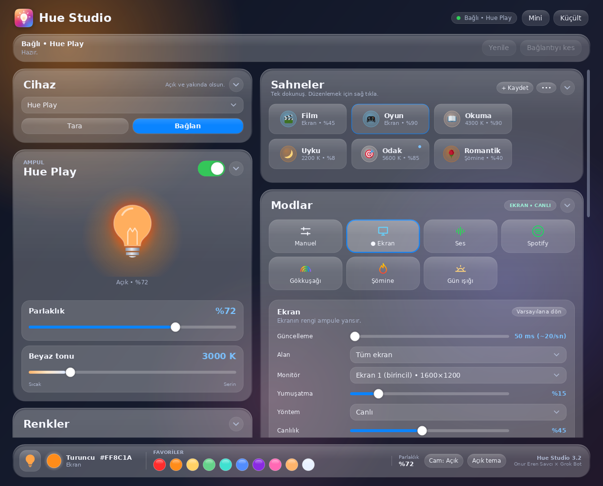
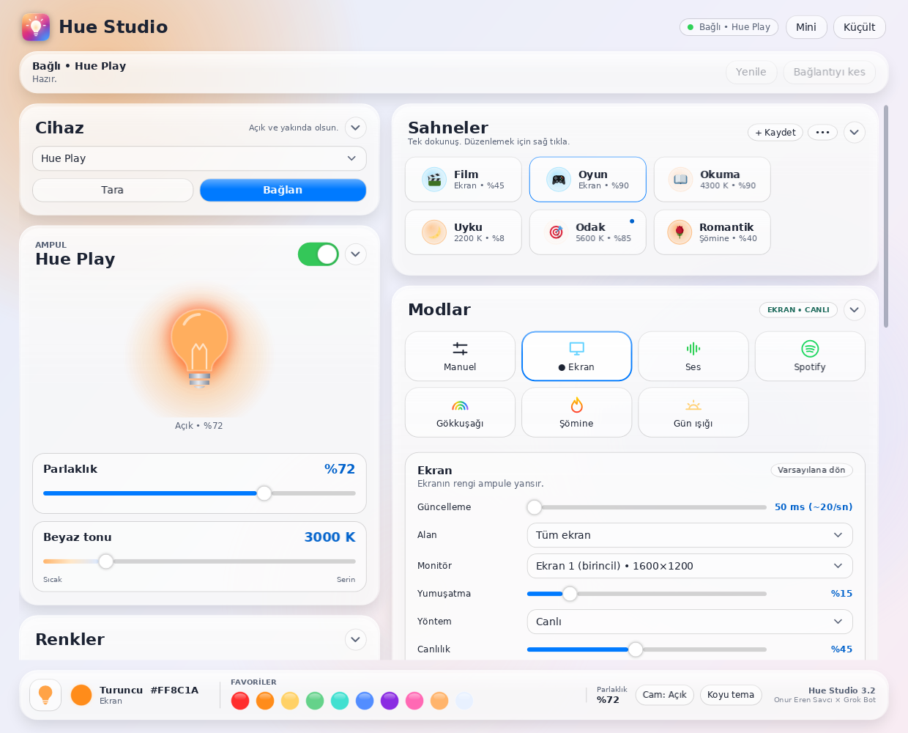
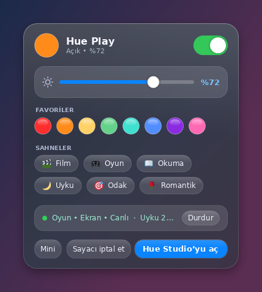
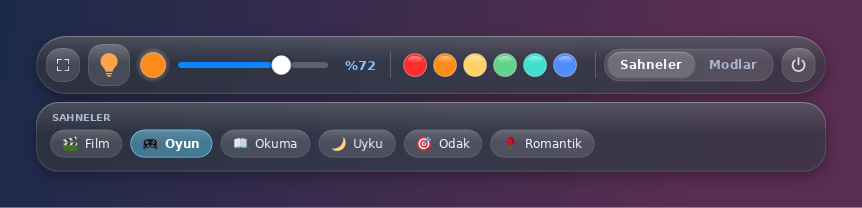
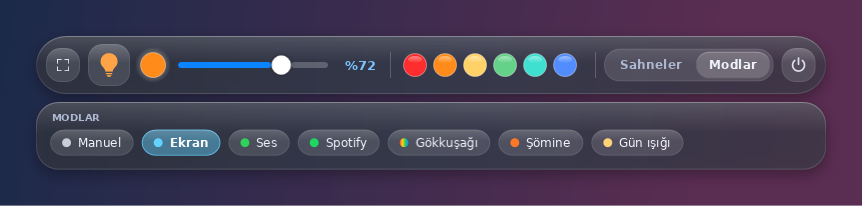
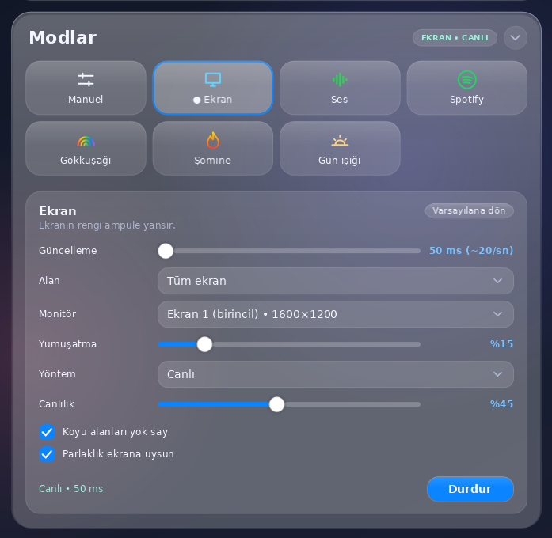

<p align="center">
  
</p>

<h1 align="center">Hue Studio</h1>

<p align="center"><b>Philips Hue Bluetooth ampullerin için şık bir Windows kumandası. Köprü yok, bulut yok, sadece ışık.</b></p>

<p align="center">
  <a href="https://github.com/onurerensavci/hue-studio/releases/latest"></a>
  
  
  
</p>

Hue Studio, Philips Hue Bluetooth ampullerini **Hue Bridge olmadan**, doğrudan bilgisayarının Bluetooth'u ile Windows'tan kontrol etmeni sağlar.
Rengi, parlaklığı ve beyaz tonunu ayarla; ekranınla, müziğinle ya da günün saatiyle senkron çalıştır.

Bu, benim bu türdeki ilk projem; fikirden tasarıma her adımını **Grok Bot** ile birlikte geliştirdim.



## ✨ Özellikler

- 🪟 **Liquid Glass arayüz**: cam efektli kartlar, koyu ve açık tema, akıcı animasyonlar.
- 🎬 **Sahneler**: Film, Oyun, Okuma, Uyku, Odak, Romantik… Her sahnenin kendi emojisi var. Tek dokunuşla uygula, şu anki ışıkla üzerine yaz, yeniden adlandır, emojisini değiştir. Hazır sahneleri istediğin zaman varsayılana sıfırla.
- 🖥️ **Ekran senkronu**: ekrandaki renk anlık olarak ampule yansır. Alan, monitör, yumuşatma, yöntem ve canlılık ayarlanabilir.
- 🎵 **Ses**: ışık müziğin ritmine ve şiddetine göre tepki verir.
- 🎧 **Spotify / müzik**: çalan şarkının albüm kapağının rengini ampule taşır.
- 🌈 **Gökkuşağı**: yönü, paleti ve hızı ayarlanabilen renk döngüsü.
- 🔥 **Şömine**: kıvılcımlı, titreşen sıcak ateş efekti.
- ☀️ **Gün ışığı**: gün boyu doğal ışığı izleyen sıcaklık ve parlaklık.
- ⏱️ **Zamanlayıcı**: uyku sayacı, gün doğumu gibi yavaşça aydınlanan uyandırma ve haftalık programlar.
- 🔔 **Bildirim ışığı**: Discord, WhatsApp, Teams, Outlook bildirimlerinde ışık kısa süre yanıp söner, sonra önceki haline döner.
- ⚡ **Hızlı panel**: saat yanındaki simgeye sol tıkla; aç/kapa, parlaklık, favoriler ve sahneler elinin altında.
- 🖱️ **Simgede tekerlekle parlaklık**: tepsi simgesinin üzerinde fare tekerleğini çevir.
- 📌 **Mini mod**: her zaman üstte duran ince çubuk. Sahneler ve Modlar sekmeleriyle açılır kompakt panel.
- 🎨 **45 hazır renk + renk çarkı**, HEX girişi ve favori renkler.
- 🚀 **Windows ile başlat**: açılışta sessizce saat yanında başlar.

## 📸 Ekran görüntüleri

| Açık tema | Hızlı panel |
| --- | --- |
|  |  |

**Mini mod: Sahneler ve Modlar**




**Mod ayarları**



## ⬇️ İndir

En son sürümü **[Releases sayfasından](https://github.com/onurerensavci/hue-studio/releases/latest)** indir: `HueStudio_v3.2.exe`.
Kurulum gerekmez; tek dosya, .NET dahil.

## 🧰 Gereksinimler

- Windows 10 (2004 / 19041 veya üstü) ya da Windows 11, 64 bit
- Bluetooth LE destekli bir Bluetooth adaptörü
- Bluetooth özellikli bir Philips Hue ampul (kutusunda Bluetooth simgesi olanlar)

## 🚦 İlk çalıştırma

1. `HueStudio_v3.2.exe` dosyasını çalıştır. Uygulama imzalı olmadığı için Windows SmartScreen uyarı verebilir:
   **Daha fazla bilgi → Yine de çalıştır**.
2. Ampulü aç ve bilgisayara yaklaştır. Ampulün Bluetooth ile keşfedilebilir olması gerekir. Gerekirse telefondaki Hue uygulamasında
   *Ayarlar → Sesli asistanlar → Görünür yap* ile ampulü görünür yap ve telefonun Hue Bluetooth bağlantısını kapat.
3. **Tara**'ya bas, ampulünü seç ve **Bağlan**. Sonraki açılışlarda otomatik bağlanır.

## ⚠️ Bilinen sınırlamalar

- Yalnızca Bluetooth ile çalışır; Hue Bridge / Zigbee üzerinden kontrol yoktur.
- Aynı anda tek ampul kontrol edilir. Bluetooth menzili birkaç metredir.
- Telefondaki Hue uygulaması ampule bağlıyken bilgisayar bağlanamayabilir.
- Ekran ve ses senkronunda hız Bluetooth ile sınırlıdır (saniyede ~20 güncelleme).
- Spotify / müzik modu Windows medya oturumu sağlayan oynatıcılarla çalışır.
- Bildirim ışığı, Windows bildirim veritabanını salt okunur yoklar; yalnızca uygulama adını okur, içeriği okumaz.
- Uygulama kod imzalı değildir (SmartScreen uyarısı bu yüzden).
- Ayarlar `%LOCALAPPDATA%\HueBluetooth` klasöründe saklanır.

## 🛠️ Kaynaktan derleme

[.NET 10 SDK](https://dotnet.microsoft.com/download) gerekir.

```bash
git clone https://github.com/onurerensavci/hue-studio.git
cd hue-studio/src/HueStudio
dotnet publish -c Release -r win-x64 --self-contained true -p:PublishSingleFile=true
```

Çıktı: `bin/Release/net10.0-windows10.0.19041.0/win-x64/publish/HueStudio.exe`

## 💬 Geri bildirim

Kullandıkça eksiklerini bulup güncelleyeceğim; öneri ve hataları [Issues](https://github.com/onurerensavci/hue-studio/issues)'a yazın.

## 🙌 Emeği geçenler

Fikir ve tasarım: **Onur Eren Savcı** • Geliştirme: **Grok Bot**

## ⚖️ Lisans ve feragat

[MIT](LICENSE) lisansı ile dağıtılır.

Bu proje Philips / Signify ile bağlantılı değildir. Philips Hue, Signify'ın tescilli markasıdır.

---

## English

**Hue Studio** is a Windows app that controls Philips Hue **Bluetooth** bulbs directly from your PC, with no Hue Bridge needed.
It has a Liquid Glass UI, emoji scenes, screen sync, audio and Spotify album-color modes, rainbow, fireplace and daylight effects,
sleep timer, sunrise wake-up, schedules, notification flashes, a tray quick panel and an always-on-top mini bar.

- **Download:** [latest release](https://github.com/onurerensavci/hue-studio/releases/latest) (`HueStudio_v3.2.exe`, no install needed).
- **Requirements:** Windows 10 2004+ / 11 (64-bit), Bluetooth LE adapter, a Bluetooth-capable Hue bulb.
- **First run:** SmartScreen may warn because the app is unsigned. Click *More info → Run anyway*. The bulb must be discoverable over Bluetooth.
- **Build:** `dotnet publish src/HueStudio -c Release -r win-x64 --self-contained true -p:PublishSingleFile=true` (.NET 10 SDK).
- The UI is in Turkish. Issues and suggestions are welcome.

Idea & design: Onur Eren Savcı • Development: Grok Bot. Not affiliated with Philips / Signify. Philips Hue is a trademark of Signify. MIT licensed.
